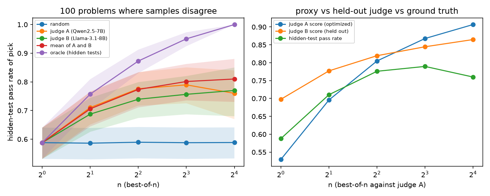

# How far can an LLM judge be gamed? Best-of-n against hidden unit tests

When outputs are selected against an LLM judge with growing pressure, does true quality keep up with the judge's score? And can a second, held-out judge give an early warning when it stops? This repo measures both on coding tasks, where hidden unit tests give exact ground truth.

**Main results** (open models, 4-bit, on one Apple-silicon laptop):

- **The judge's score of its pick keeps rising after true quality stops improving.** From best-of-1 to best-of-16 against a 7B judge, the judge's score of its pick rose from 0.52 to 0.90. The hidden-test pass rate of that pick peaked at n=8 (0.76) and was 0.73 at n=16.
- **Confidently wrong picks grow with pressure.** The pick is wrong although the judge says P(correct) > 0.9 in 7.6% of cases at n=1 and in 20.0% at n=16.
- **A held-out judge from another model family gave no early warning. It agreed more, not less.** Disagreement between the two judges on the selected output fell from 31% to 10% as pressure grew (change -21 points, 95% CI -27 to -15). In the same range, confidently wrong picks rose from 7% to 19%.



## Setup

| | |
|---|---|
| Tasks | EvalPlus MBPP+ and HumanEval+, 527 of 542 problems. 14 were dropped because the test file has no per-input loop (10) or the function name cannot be parsed (4), and 1 because its reference solution fails its own test. Median 111 hidden tests per problem. |
| Policy | Qwen2.5-Coder-1.5B-Instruct (MLX, 4-bit), 16 samples per problem, temperature 1.0, top-p 0.95 |
| Ground truth | A sample is correct if it passes every hidden test. Each sample runs in a macOS sandbox (no network, no writes to the home folder) with a 2 s per-test timeout and an 800 MB memory cap. |
| Judge A (optimized against) | Qwen2.5-7B-Instruct (4-bit), same model family as the policy |
| Judge B (held out) | Llama-3.1-8B-Instruct (4-bit), never used for selection |
| Judge score | P(Yes) / (P(Yes) + P(No)) for "Does this solution correctly solve the task for all valid inputs?", read from one forward pass |
| Best-of-n | For n in {1, 2, 4, 8, 16}, the pick is the sample with the highest judge score among n drawn from the 16. Results average 2,000 to 4,000 random subsets per problem, with the same subsets for every selector. |
| Problems analyzed | 48.8% of all samples pass. In 355 problems the 16 samples disagree, which is the only case where selection can matter. Judge A scored a random 150 of these, stratified by benchmark. Judge B scored a random 100 of those 150. |

## Results

**Judge A under growing selection pressure** (150 problems, `results/judgeA_150.md`):

| | n=1 | n=2 | n=4 | n=8 | n=16 |
|---|---|---|---|---|---|
| hidden-test pass rate of judge A's pick | 0.562 | 0.680 | 0.740 | 0.756 | 0.733 |
| judge A's own score of its pick | 0.515 | 0.677 | 0.789 | 0.855 | 0.898 |
| pick is wrong although judge A says P(Yes) > 0.9 | 0.076 | 0.103 | 0.130 | 0.161 | 0.200 |
| best possible pick (oracle) | 0.562 | 0.728 | 0.847 | 0.938 | 1.000 |

- From n=1 to n=8 the pass rate of the pick rises by 19.5 points (95% CI 15.9 to 23.1).
- From n=8 to n=16 it changes by -2.3 points (95% CI -5.6 to +1.0). So it stops improving, but the drop itself is not significant (35 problems got worse, 45 better).

**Does the held-out judge warn?** (100 problems scored by both judges, `results/tables.md`, `results/paired_tests.md`)

| selection against judge A, n = | 1 | 2 | 4 | 8 | 16 |
|---|---|---|---|---|---|
| hidden-test pass rate of the pick | 0.588 | 0.711 | 0.776 | 0.790 | 0.760 |
| judge A's score of the pick | 0.530 | 0.696 | 0.805 | 0.868 | 0.907 |
| held-out judge B's score of the same pick | 0.698 | 0.777 | 0.820 | 0.845 | 0.865 |
| A and B disagree on the pick (verdict at 0.5) | 0.309 | 0.249 | 0.185 | 0.138 | 0.100 |
| pick is wrong although A says P(Yes) > 0.9 | 0.073 | 0.098 | 0.118 | 0.146 | 0.190 |

| selector: pass rate of the pick | n=1 | n=4 | n=8 | n=16 |
|---|---|---|---|---|
| judge A | 0.588 | 0.776 | 0.790 | 0.760 |
| judge B | 0.588 | 0.739 | 0.757 | 0.770 |
| mean of A and B | 0.588 | 0.774 | 0.801 | 0.810 |
| oracle | 0.588 | 0.873 | 0.950 | 1.000 |

## Findings

1. **Selection against an LLM judge helps at first, then true quality stalls while the judge's score keeps rising.** This is the overoptimization pattern Gao et al. (2023) found for reward models, here at small n with an LLM judge.
2. **More pressure surfaces more outputs that fool the judge.** The share of confidently wrong picks rises steadily, from 7.6% to 20.0%.
3. **Cross-judge disagreement was not an early warning here.** The outputs that fool judge A also tend to fool judge B: disagreement falls as pressure grows, and B's score of the pick keeps rising.
   - Among judge A's top pick per problem, B separates right from wrong only weakly (AUROC 0.58, against 0.63 for A itself).
   - Disagreement identifies the 24 problems where selection against A did worse than random at chance level (AUROC 0.52).
4. **Using both judges as the selector looks better, but the effect is not significant.** At n=16 the mean of A and B picks a correct sample 81.0% of the time, against 76.0% for A alone (+5.0 points, 95% CI -2.0 to +12.0).
5. **Judge B is much weaker and lenient.** Per sample, A separates right from wrong with AUROC 0.82 and B with 0.69. B accepts 74% of samples, including 59% of wrong ones.

## Limitations

- One policy model, two judges, n only up to 16, and 100 problems for the two-judge analysis.
- Judge A and the policy are both Qwen models, so self-preference may play a part.
- Judge B is weaker than judge A. A stronger held-out judge, or one that differs in kind (for example a rule-based checker), might disagree more usefully.
- Sampling is stochastic. The released `data/` holds the exact samples, so every table can be recomputed exactly.

## Reproduce

Requirements:
- An Apple-silicon Mac (MLX) with 24 GB of memory.
- Python 3.12.
- About 10 GB of disk for the models, which are downloaded from Hugging Face on first use.

```bash
python -m venv .venv && source .venv/bin/activate
pip install -r requirements.txt

# recompute every table and figure from the released data (seconds)
python scripts/04_analyze.py
python scripts/05_judge_a_150.py
python scripts/06_paired_tests.py

# or rerun everything from scratch (about 3.5 h)
bash reproduce.sh
```

## Layout

```
harness/      shared code
  common.py       problem loading, the policy prompt, sandboxed execution with a memory watchdog, the LLM judge
  runner_exec.py  runs inside the sandbox, records one pass/fail bit per hidden test
  bon.py          best-of-n simulation from a fixed pool, AUROC, bootstrap CIs
  memguard.py     optional system-wide memory safety net
scripts/      the pipeline, numbered in order (see reproduce.sh)
data/         every intermediate file
  generations_n16.json.gz   samples
  exec_n16.json.gz          per-test results
  judge_A.json.gz, judge_B.json.gz   judge scores
  judged_problems.json      the judged subset
results/      tables, JSON and the figure
```

## Related work

- L. Gao, J. Schulman, J. Hilton. *Scaling Laws for Reward Model Overoptimization.* ICML 2023.
- J. Liu, C. S. Xia, Y. Wang, L. Zhang. *Is Your Code Generated by ChatGPT Really Correct? Rigorous Evaluation of Large Language Models for Code Generation* (EvalPlus). NeurIPS 2023.

Companion projects with the same samples and harness:
- `test-suite-reduction-for-selection`: how few tests a verifier needs.
- `metamorphic-testing-of-llm-judges`: rewrites that keep behavior, and routing judge errors.

## Citation

```bibtex
@misc{malik2026judgegaming,
  author = {Muhammad Ghaus Malik},
  title  = {How Far Can an LLM Judge Be Gamed? Best-of-n Against Hidden Unit Tests},
  year   = {2026},
  note   = {Pilot study, code and data}
}
```
